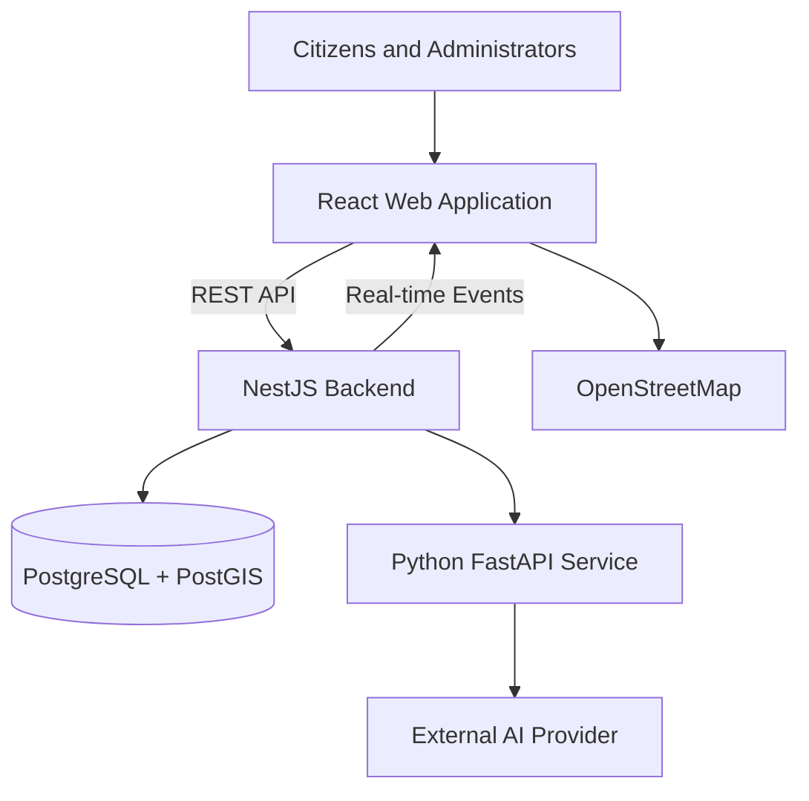

# ARROYO ALERT

### Citizen Reporting & Intelligent Flood Monitoring Platform

[](https://github.com/cesarvega1/arroyo-alert/actions)


---

## About the Project

ARROYO ALERT is a citizen reporting and intelligent
flood monitoring platform designed to address urban
flooding challenges in Barranquilla, Colombia.

The platform aims to connect citizens, geographic
information, real-time communication and artificial
intelligence to improve access to information about
flooding and dangerous urban water streams.

## The Problem

Heavy rainfall in Barranquilla can generate dangerous
urban water streams, flooding, mobility disruptions
and risks to local communities.

Access to timely, organized and geographically
accurate community information can be limited.

ARROYO ALERT aims to address this challenge through
a centralized community reporting platform.

## Our Solution

The platform will allow users to:

- Submit geolocated citizen reports.
- Attach photographic evidence.
- Visualize reports and incidents on interactive maps.
- Receive real-time community alerts.
- Access AI-assisted incident classifications.
- Monitor validated incidents.
- Participate in community-driven information sharing.

The system will include administrative and
moderation capabilities to improve information quality.

## Project Objectives

- Build a scalable and maintainable software platform.
- Improve access to community flood-related information.
- Integrate geospatial technologies.
- Support responsible artificial intelligence integration.
- Apply professional software engineering practices.
- Establish a foundation for future entrepreneurship.

## System Architecture

ARROYO ALERT uses a modular monolith architecture
for its core backend with a planned independent
artificial intelligence service.



The diagram represents the target MVP architecture,
including components that are still planned.

## Technology Stack

### Backend — Implemented Foundation

| Technology | Purpose |
|---|---|
| Node.js 24 | JavaScript runtime |
| NestJS | Backend framework |
| TypeScript | Type-safe development |
| TypeORM | Database integration |
| Zod | Configuration validation |

### Frontend — Planned

| Technology | Purpose |
|---|---|
| React | User interface |
| TypeScript | Type-safe development |
| Vite | Build tooling |
| Tailwind CSS | Responsive styling |
| Leaflet | Interactive maps |
| OpenStreetMap | Geographic map data |

### Database — Implemented

| Technology | Purpose |
|---|---|
| PostgreSQL 16 | Relational database |
| PostGIS 3.7 | Geospatial capabilities |
| TypeORM Migrations | Schema management |

### Artificial Intelligence — Planned

| Technology | Purpose |
|---|---|
| Python | AI service development |
| FastAPI | AI service interfaces |
| External AI API | AI-assisted report analysis |

### Infrastructure and Quality

| Technology | Purpose |
|---|---|
| Docker | Containerization |
| Docker Compose | Local infrastructure |
| GitHub Actions | Continuous integration |
| Vitest | Automated testing |
| Supertest | End-to-end testing |
| Oxlint | Static analysis |
| Prettier | Code formatting |

## Repository Structure

```text
arroyo-alert/
├── frontend/          # Planned frontend application
├── backend/           # NestJS REST API
├── ai-service/        # Planned AI service
├── infrastructure/   # Docker Compose configuration
├── docs/             # Technical documentation
├── .github/
│   └── workflows/    # CI workflows
├── .editorconfig
├── .gitignore
└── README.md
```

## Getting Started

### Prerequisites

- Node.js 24
- npm
- Git
- Docker
- Docker Compose

### Clone the Repository

```bash
git clone https://github.com/cesarvega1/arroyo-alert.git

cd arroyo-alert

git switch develop
```

### Configure Infrastructure

Navigate to the infrastructure directory:

```bash
cd infrastructure
```

Create the local .env file from .env.example
and configure the database credentials.

Start PostgreSQL and PostGIS:

```bash
docker compose up -d
docker compose ps
```

### Configure the Backend

```bash
cd ../backend
npm ci
```

Create the following files from their templates:

- .env
- .env.test

Ensure that the database credentials match
the infrastructure configuration.

Apply development and testing migrations:

```bash
npm run migration:run
npm run migration:run:test
```

Start the application:

```bash
npm run start:dev
```

For detailed installation instructions, see the
[Getting Started Guide](docs/development/getting-started.md).

## API Endpoints

Currently implemented endpoints:

| Method | Endpoint | Description |
|---|---|---|
| GET | /api/v1 | API information |
| GET | /api/v1/health | Application and database health |

Local API URL:

http://localhost:3000/api/v1

## Database Architecture

The proposed MVP database model contains 13
business tables covering:

- Users and authentication.
- Roles and permissions.
- Citizen reports.
- Incident categories.
- Incidents.
- Report evidence.
- AI analysis.
- Moderation.
- Alerts.
- Audit logs.

PostGIS will enable spatial queries, geographic
indexes and location-based incident monitoring.

Business entities are planned for upcoming sprints.

See the complete
[Database Design](docs/architecture/database-design.md).

## Testing

Run these commands from the backend directory.

### Unit Tests

```bash
npm run test
```

### End-to-End Tests

```bash
npm run test:e2e
```

### Code Coverage

```bash
npm run test:cov
```

The testing database must be running with all
required migrations applied before E2E execution.

### Initial Quality Baseline

Results recorded after AA-007:

| Metric | Result |
|---|---:|
| Unit tests | 51 passed |
| End-to-end tests | 7 passed |
| Total tests | 58 passed |
| Statement coverage | 100% |
| Branch coverage | 83.33% |
| Function coverage | 100% |
| Line coverage | 100% |

Coverage applies to the files included in the
AA-007 local coverage report.

## Continuous Integration

GitHub Actions automatically validates:

- Repository structure.
- Environment file protection.
- Code formatting.
- Static analysis.
- Unit tests.
- PostgreSQL and PostGIS integration.
- Database migrations.
- End-to-end tests.
- Application compilation.
- Docker Compose configuration.

Continuous deployment is planned for future stages.

## Development Methodology

ARROYO ALERT follows an incremental development
approach based on Scrum practices adapted to
the current development team.

Project management practices include:

- Product backlog.
- Sprint planning.
- Task identifiers.
- Acceptance criteria.
- Conventional Commits.
- Pull requests.
- Continuous integration.
- Architecture Decision Records.
- Definition of Done.

## Development Roadmap

### Phase 1 — Project Foundation

- [x] Repository setup
- [x] Monorepo architecture
- [x] Branch strategy
- [x] NestJS initialization
- [x] Environment configuration
- [x] Docker Compose infrastructure
- [x] PostgreSQL and PostGIS integration
- [ ] Technical documentation review and integration

### Phase 2 — Core Backend

- [ ] User management
- [ ] Authentication
- [ ] Roles and permissions
- [ ] Incident categories
- [ ] Citizen reports
- [ ] Evidence management
- [ ] Incident management
- [ ] Moderation
- [ ] Audit logs

### Phase 3 — Intelligence and Real-Time Features

- [ ] AI service integration
- [ ] AI-assisted report classification
- [ ] Real-time communication
- [ ] Community alerts

### Phase 4 — Frontend Application

- [ ] Responsive interface
- [ ] Authentication views
- [ ] Citizen reporting interface
- [ ] Interactive maps
- [ ] Administrative dashboard

### Phase 5 — Deployment and MVP Validation

- [ ] Production infrastructure
- [ ] Continuous deployment
- [ ] Security review
- [ ] Performance testing
- [ ] Pilot validation

The roadmap represents planned development
phases and may evolve according to project needs.

## Technical Documentation

Explore the complete
[Technical Documentation](docs/README.md).

### Architecture

- [System Overview](docs/architecture/system-overview.md)
- [Backend Architecture](docs/architecture/backend-architecture.md)
- [Database Design](docs/architecture/database-design.md)

### Architecture Decision Records

- [ADR 0001 — Monorepo Architecture](docs/adr/0001-monorepo-architecture.md)
- [ADR 0002 — Technology Stack](docs/adr/0002-technology-stack.md)
- [ADR 0003 — Database Migrations](docs/adr/0003-database-migrations.md)
- [ADR 0004 — Environment Isolation](docs/adr/0004-environment-isolation.md)
- [ADR 0005 — AI Service Architecture](docs/adr/0005-ai-service-architecture.md)

### Development Guides

- [Getting Started](docs/development/getting-started.md)
- [Git Workflow](docs/development/git-workflow.md)
- [Coding Standards](docs/development/coding-standards.md)
- [Testing Strategy](docs/testing/testing-strategy.md)
- [CI/CD Strategy](docs/devops/ci-cd.md)
- [Backend Documentation](backend/README.md)

## Security and Responsible AI

ARROYO ALERT follows secure development practices,
database isolation and automated validation.

AI-generated recommendations must remain advisory
and require appropriate human oversight.

Community reports and alerts do not guarantee
safe conditions.

The platform does not replace official emergency
management authorities.

## Author

**Cesar Vega Morales**

Software Developer

- GitHub: https://github.com/cesarvega1
- Location: Barranquilla, Colombia

## Project Status

Under active development.

ARROYO ALERT is being developed as a professional
software engineering portfolio project with potential
for future entrepreneurship and community impact.

---

**ARROYO ALERT — Technology for informed communities.**