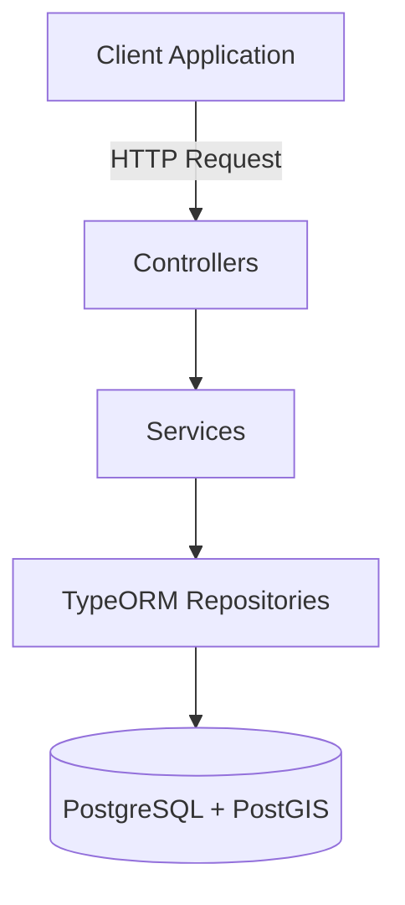
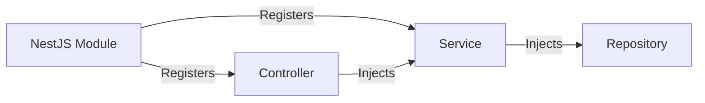
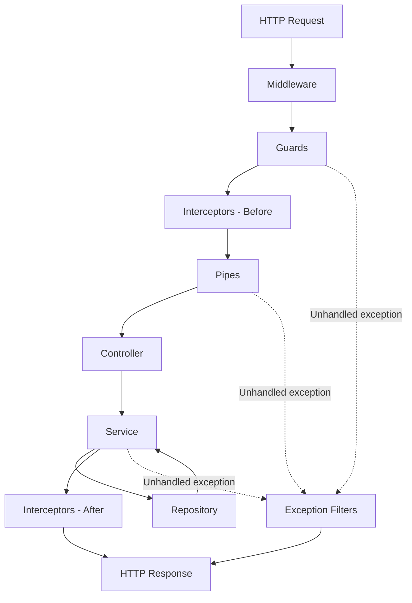

# ARROYO ALERT — Backend Architecture

## 1. Overview

The ARROYO ALERT backend is built using NestJS and
TypeScript, following a modular monolith architecture.

The architecture promotes separation of concerns,
maintainability, testability, security and scalability.

Business capabilities are organized into independent
NestJS modules within a single backend application.

## 2. Technology Stack

| Technology | Purpose |
|---|---|
| Node.js 24 | JavaScript runtime |
| NestJS 12 | Backend framework |
| TypeScript | Type-safe development |
| TypeORM | Object-relational mapping |
| PostgreSQL 16 | Relational database |
| PostGIS 3.7 | Geospatial data management |
| Zod | Configuration validation |
| Vitest | Automated testing |
| Supertest | HTTP integration testing |
| Oxlint | Static code analysis |
| Prettier | Code formatting |

## 3. Architectural Pattern

The backend follows a modular monolith architecture.

Each business module encapsulates its own responsibilities
and communicates with other modules through defined
service interfaces.



## 4. Application Layers

### 4.1 Controllers

Controllers handle incoming HTTP requests, delegate
operations to services and return HTTP responses.

Controllers should not contain business logic or
direct database queries.

### 4.2 Services

Services implement business rules, coordinate
application operations and communicate with repositories
or external services.

### 4.3 Repositories

TypeORM repositories provide access to persistent data.

They are responsible for database operations such as:

- Creating records.
- Finding records.
- Updating records.
- Deleting records.
- Executing database queries.

Custom repositories may be introduced when complex
queries require additional abstraction.

### 4.4 Entities

Entities define the database persistence model.

They represent tables, columns, relationships,
constraints and database indexes.

### 4.5 Data Transfer Objects

DTOs define the structure of data exchanged through
application interfaces.

They should remain independent from persistence entities
and prevent direct exposure of sensitive fields.

## 5. Backend Directory Structure

### Current Foundation

```text
backend/
├── src/
│   ├── config/
│   │   ├── configuration/
│   │   ├── schemas/
│   │   └── validators/
│   ├── database/
│   │   ├── migrations/
│   │   ├── data-source.ts
│   │   └── database.module.ts
│   ├── modules/
│   │   └── health/
│   │       ├── health.controller.ts
│   │       ├── health.controller.spec.ts
│   │       ├── health.service.ts
│   │       ├── health.service.spec.ts
│   │       └── health.module.ts
│   ├── app.controller.ts
│   ├── app.controller.spec.ts
│   ├── app.service.ts
│   ├── app.module.ts
│   └── main.ts
├── test/
├── .env.example
├── .env.test.example
├── package.json
└── README.md
```

### Planned Business Module Structure

Each business module should follow a consistent structure.

```text
modules/
└── reports/
    ├── dto/
    │   ├── create-report.dto.ts
    │   └── update-report.dto.ts
    ├── entities/
    │   └── report.entity.ts
    ├── enums/
    ├── reports.controller.ts
    ├── reports.controller.spec.ts
    ├── reports.service.ts
    ├── reports.service.spec.ts
    └── reports.module.ts
```

Additional directories should only be introduced when
required by the complexity of the module.

## 6. Application Modules

| Module | Responsibility | Status |
|---|---|---|
| Health | Application and database health | Implemented |
| Auth | Authentication and token management | Planned |
| Users | User management | Planned |
| Roles | Role and permission management | Planned |
| Reports | Citizen report management | Planned |
| Categories | Incident categories | Planned |
| Incidents | Validated incident management | Planned |
| Evidence | Report evidence management | Planned |
| Moderation | Report verification and moderation | Planned |
| Alerts | Community alerts | Planned |
| AI | AI service integration | Planned |
| Audit | Security and activity audit logs | Planned |

## 7. Dependency Injection

NestJS dependency injection is used to manage
dependencies between application components.



Dependencies should be injected through constructors.

This approach improves testability and reduces
coupling between application components.

## 8. Database Architecture

The backend uses TypeORM to communicate with PostgreSQL.

PostGIS provides geographic data types, spatial indexes
and location-based queries.

Database configuration is centralized through
NestJS ConfigModule and validated using Zod.

Database management rules:

- Automatic synchronization is disabled.
- Automatic schema deletion is disabled.
- Schema changes require versioned migrations.
- Development and testing databases are isolated.
- Database credentials must not be committed.
- UUIDs will be used for business entity identifiers.
- Geographic report locations will use SRID 4326.
- Date and time values will be managed in UTC.

## 9. API Design

The backend exposes a versioned REST API.

Base path:

`/api/v1`

### Implemented Endpoints

| Method | Endpoint | Description |
|---|---|---|
| GET | /api/v1 | API information |
| GET | /api/v1/health | Application and database health |

### HTTP Status Codes

| Code | Description |
|---|---|
| 200 | Successful request |
| 201 | Resource created |
| 204 | Successful request without response body |
| 400 | Invalid request |
| 401 | Authentication required |
| 403 | Insufficient permissions |
| 404 | Resource not found |
| 409 | Resource conflict |
| 500 | Internal server error |
| 503 | Service unavailable |

API documentation through Swagger is planned.

## 10. Request Lifecycle

The following diagram represents the planned NestJS
request processing architecture.



Middleware, guards, pipes, interceptors and custom
exception filters will be introduced as required.

## 11. Security Architecture

The planned security architecture includes:

- JWT-based authentication.
- Access and refresh tokens.
- Role-based access control.
- Permission-based authorization.
- Secure password hashing.
- Request validation.
- Rate limiting.
- CORS configuration.
- Audit logging.
- Environment variable protection.
- Sensitive data filtering.

Security must be considered throughout the
development lifecycle.

## 12. Health Monitoring

The implemented health endpoint verifies PostgreSQL
availability using a lightweight SQL query.

`GET /api/v1/health`

The endpoint returns HTTP 200 when the database
health query succeeds and HTTP 503 when it fails.

This endpoint represents application readiness and
database availability, not comprehensive system monitoring.

## 13. Testing Architecture

The backend follows an automated testing strategy
using Vitest and Supertest.

### Unit Tests

Unit tests verify individual components using
isolated and mocked dependencies.

### End-to-End Tests

End-to-end tests verify HTTP behavior and integration
with a dedicated PostgreSQL testing database.

### Continuous Integration

GitHub Actions validates:

- Code formatting.
- Static analysis.
- Unit tests.
- Database migrations.
- End-to-end tests.
- Application compilation.

At the completion of task AA-007, the backend
contained 51 passing unit tests and 7 passing
end-to-end tests.

## 14. Artificial Intelligence Integration

The backend will communicate with an independent
Python FastAPI service.

The AI service will assist with report analysis and
classification without becoming the authoritative
source of emergency decisions.

The backend remains responsible for business rules,
authorization and persistence.

AI-assisted recommendations require appropriate
validation and human oversight.

## 15. Architectural Rules

- Controllers must not contain business logic.
- Services must have clearly defined responsibilities.
- Modules must minimize coupling.
- Dependencies must use dependency injection.
- DTOs and entities must remain independent.
- Database changes must use migrations.
- Tests must not connect to development databases.
- Sensitive information must not appear in logs.
- New business functionality must include tests.
- All changes must pass continuous integration.
- Code and technical documentation must use English.

## 16. Architecture Evolution

The modular monolith is the initial architecture
for the ARROYO ALERT MVP.

Future architectural changes must be justified by
measurable requirements, operational constraints
or significant changes in system complexity.

Microservices should not be introduced without
a clear technical or business justification.

Architecture decisions must be documented using
Architecture Decision Records (ADRs).