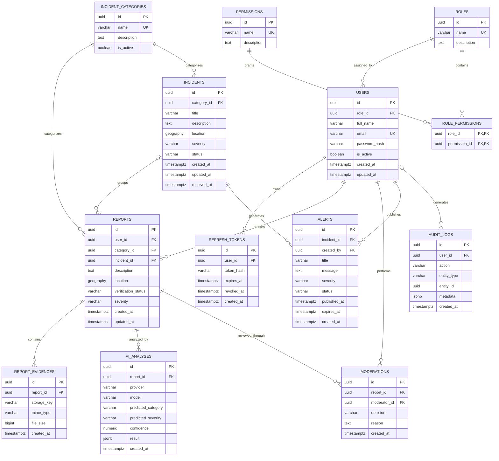

# ARROYO ALERT — Database Design

## 1. Overview

ARROYO ALERT uses PostgreSQL as its primary relational
database and PostGIS for geospatial data management.

The database architecture is designed to support:

- User management and authentication.
- Role-based access control.
- Geolocated citizen reports.
- Incident management.
- Evidence storage references.
- AI-assisted report analysis.
- Report moderation.
- Community alerts.
- Activity and security audit logs.

This document describes the proposed database model
for the MVP.

Business entities have not yet been implemented.
The final schema will be defined through versioned
TypeORM migrations.

## 2. Database Technologies

| Technology | Purpose |
|---|---|
| PostgreSQL 16 | Relational database management |
| PostGIS 3.7 | Geospatial data management |
| TypeORM | Object-relational mapping |
| Docker Compose | Local database infrastructure |
| Zod | Database configuration validation |
| DBeaver | Database administration |

## 3. Database Design Principles

- Relational database normalization.
- UUID identifiers for business entities.
- Referential integrity through foreign keys.
- Explicit database constraints.
- Consistent snake_case naming conventions.
- UTC timestamp management.
- Secure credential storage.
- Geospatial indexing.
- Migration-based schema management.
- Separation of development and testing environments.
- Data minimization and privacy protection.

## 4. Database Environments

| Environment | Database | Port | User |
|---|---|---|---|
| Development | arroyo_alert | 5434 | arroyo |
| Testing | arroyo_alert_test | 5435 | arroyo_test |

Both environments run independently using Docker.

Testing database isolation is enforced through
environment validation and database identity checks.

Production infrastructure will be defined separately.

## 5. Entity Relationship Diagram

The following diagram represents the proposed
logical database model.



## 6. Database Tables

### 6.1 roles

Defines the available application roles.

Initial proposed roles:

- ADMIN
- MODERATOR
- CITIZEN

Each user belongs to one role in the initial MVP.

### 6.2 permissions

Stores granular application permissions.

Examples:

- users.read
- users.manage
- reports.create
- reports.read
- reports.moderate
- incidents.manage
- alerts.publish
- audit.read

The final permission catalog will be defined during
authentication and authorization implementation.

### 6.3 role_permissions

Associates roles with permissions through a
many-to-many relationship.

The combination of role_id and permission_id
forms a composite primary key.

This prevents duplicate permission assignments.

### 6.4 users

Stores registered application users.

Responsibilities:

- User identification.
- Authentication credentials.
- Role assignment.
- Account activation.
- Account timestamps.

User emails must be unique and normalized.

Passwords must never be stored in plain text.

### 6.5 refresh_tokens

Stores refresh token references and their lifecycle.

Responsibilities:

- Session renewal.
- Token expiration.
- Token revocation.
- Session security.

Only secure token hashes must be stored.

A user may have multiple refresh tokens associated
with different sessions.

### 6.6 incident_categories

Stores configurable categories of reports
and incidents.

Initial proposed categories:

- STRONG_CURRENT
- FLOODING
- WATER_ACCUMULATION
- VEHICLE_AFFECTED
- DRAINAGE_BLOCKAGE
- OTHER

Categories are stored in a dedicated table to
support future administrative configuration.

### 6.7 reports

Stores citizen-generated reports.

A report contains:

- Reporting user.
- Incident category.
- Description.
- Geographic location.
- Verification status.
- Severity level.
- Optional associated incident.
- Creation and update timestamps.

A report represents citizen-submitted information
and must not automatically be considered a
verified incident.

The incident_id field may be null until the report
is associated with an incident.

### 6.8 report_evidences

Stores references to evidence associated with reports.

Supported evidence may include:

- Photographs.
- Additional supported media types.

The database stores file metadata and storage
references rather than large binary files.

The storage provider will be selected during
evidence management implementation.

### 6.9 incidents

Represents consolidated events associated with
one or more citizen reports.

Multiple reports may describe the same real-world
flooding event.

Grouping reports into incidents helps reduce
duplicate information and improves monitoring.

An incident maintains its own lifecycle and severity,
independent of individual report verification.

### 6.10 ai_analyses

Stores AI-assisted analysis results.

Responsibilities:

- Suggested incident classification.
- Suggested severity.
- Confidence information when available.
- Provider and model identification.
- Structured analysis results.

Multiple analyses may be associated with a report.

AI-generated classifications are advisory and
must not automatically verify reports, publish alerts
or replace human moderation.

Confidence values must not be interpreted as
guarantees of accuracy or safety.

### 6.11 moderations

Stores moderation decisions and review history.

Each moderation record identifies:

- The reviewed report.
- The moderator responsible.
- The moderation decision.
- The reason for the decision.
- The decision timestamp.

Moderation history must be preserved for
accountability and traceability.

### 6.12 alerts

Stores community alerts associated with incidents.

An alert contains:

- Related incident.
- Responsible publisher.
- Title and message.
- Severity.
- Publication status.
- Publication and expiration timestamps.

Alerts require appropriate authorization.

Community alerts do not replace official
emergency warnings.

### 6.13 audit_logs

Records security-related and relevant business events.

Examples:

- Authentication events.
- Role modifications.
- Permission modifications.
- Report moderation.
- Incident status changes.
- Alert publication.

The user_id field may be null for system-generated
events or events without an identified user.

Audit metadata must not include passwords, tokens
or unnecessary sensitive personal information.

## 7. Proposed Enumerations

The final enumeration values will be confirmed
when implementing the corresponding modules.

### Report Verification Status

| Value | Description |
|---|---|
| PENDING | Waiting for review |
| UNDER_REVIEW | Currently being reviewed |
| VERIFIED | Accepted by moderation |
| REJECTED | Rejected by moderation |

### Incident Status

| Value | Description |
|---|---|
| OPEN | Incident has been registered |
| ACTIVE | Incident is currently active |
| RESOLVED | Incident has been resolved |
| CLOSED | Incident lifecycle has ended |

### Severity

| Value | Description |
|---|---|
| LOW | Low estimated severity |
| MEDIUM | Moderate estimated severity |
| HIGH | High estimated severity |
| CRITICAL | Critical estimated severity |

### Alert Status

| Value | Description |
|---|---|
| DRAFT | Alert has not been published |
| PUBLISHED | Alert has been published |
| EXPIRED | Alert validity period has ended |
| CANCELLED | Alert has been cancelled |

### Moderation Decision

| Value | Description |
|---|---|
| APPROVED | Report accepted |
| REJECTED | Report rejected |
| REQUEST_CHANGES | Additional information required |

Report verification, incident status and severity
represent independent concepts.

## 8. Database Relationships

| Parent | Child | Relationship |
|---|---|---|
| roles | users | One-to-many |
| roles | permissions | Many-to-many |
| users | refresh_tokens | One-to-many |
| users | reports | One-to-many |
| incident_categories | reports | One-to-many |
| incident_categories | incidents | One-to-many |
| incidents | reports | One-to-many, optional for reports |
| reports | report_evidences | One-to-many |
| reports | ai_analyses | One-to-many |
| reports | moderations | One-to-many |
| users | moderations | One-to-many |
| incidents | alerts | One-to-many |
| users | alerts | One-to-many |
| users | audit_logs | One-to-many, optional actor |

Foreign key deletion behavior must be defined
explicitly in database migrations.

Historical incident, moderation and audit records
must not be removed through uncontrolled cascades.

## 9. Geospatial Data Management

PostGIS enables geographic data storage and
location-based queries.

Report and incident locations will use:

`geography(Point, 4326)`

SRID 4326 represents the WGS 84 coordinate system.

Geographic points use longitude followed by latitude.

Example:

```sql
SELECT ST_SetSRID(
    ST_MakePoint(-74.7813, 10.9685),
    4326
)::geography;
```

This example represents an illustrative geographic
point in Barranquilla.

The application must validate geographic coordinates
before storing them.

Valid longitude range:

- -180 to 180 degrees.

Valid latitude range:

- -90 to 90 degrees.

## 10. Spatial Queries

PostGIS will support:

- Nearby report searches.
- Geographic incident grouping.
- Distance calculations.
- Location-based alert filtering.
- Map visualization queries.

Example of a radius search:

```sql
SELECT id, description
FROM reports
WHERE ST_DWithin(
    location,
    ST_SetSRID(
        ST_MakePoint(-74.7813, 10.9685),
        4326
    )::geography,
    1000
);
```

This query finds reports within approximately
1,000 meters of the specified geographic point.

Geographic proximity alone does not establish
that two reports describe the same incident.

## 11. Database Indexing

The initial indexing strategy includes:

| Table | Column | Index Type |
|---|---|---|
| users | email | Unique |
| roles | name | Unique |
| permissions | name | Unique |
| incident_categories | name | Unique |
| refresh_tokens | token_hash | Unique |
| reports | location | GiST |
| reports | user_id | B-tree |
| reports | category_id | B-tree |
| reports | incident_id | B-tree |
| reports | verification_status | B-tree |
| reports | created_at | B-tree |
| incidents | location | GiST |
| incidents | status | B-tree |
| incidents | created_at | B-tree |
| report_evidences | report_id | B-tree |
| ai_analyses | report_id | B-tree |
| moderations | report_id | B-tree |
| alerts | incident_id | B-tree |
| audit_logs | created_at | B-tree |

Example of a spatial index:

```sql
CREATE INDEX idx_reports_location
ON reports
USING GIST (location);
```

Additional indexes will be introduced based on
actual query patterns and performance measurements.

## 12. Data Integrity

Database constraints will include:

- Primary keys.
- Foreign keys.
- Unique constraints.
- NOT NULL constraints.
- CHECK constraints.
- Composite primary keys.

Business rules must be enforced through an
appropriate combination of database constraints
and application services.

Database transactions will be used when multiple
operations must succeed or fail together.

## 13. Database Normalization

The proposed relational model aims to follow
the first three normal forms where practical.

### First Normal Form (1NF)

- Each record has a unique identifier.
- Relational attributes contain atomic values.
- Repeating relational groups are separated.

### Second Normal Form (2NF)

- Non-key attributes depend on the complete
  primary key.

### Third Normal Form (3NF)

- Non-key attributes should not depend
  transitively on other non-key attributes.

JSONB may be used for flexible AI analysis
results and audit metadata.

Core relational business data must remain
structured and queryable.

## 14. Database Security

- Passwords must be securely hashed.
- Refresh tokens must be stored as secure hashes.
- Database credentials must not be committed.
- Development and testing databases must remain isolated.
- Database access must follow least privilege.
- SQL queries must be parameterized.
- Sensitive information must not be exposed in responses.
- Production database access must be restricted.
- Citizen location data requires appropriate privacy controls.
- Evidence files require access and retention policies.

## 15. Migration Strategy

Database schema changes are managed through TypeORM.

The following options are disabled:

- synchronize
- dropSchema
- migrationsRun

The initial implemented migration is:

`1795890080624-EnablePostGIS.ts`

This migration ensures that the PostGIS extension
is available.

Executed migrations are tracked through:

`typeorm_migrations`

Migration commands:

```bash
npm run migration:create -- src/database/migrations/MigrationName

npm run migration:show

npm run migration:run

npm run migration:show:test

npm run migration:run:test
```

Migrations must be reviewed and tested before
being applied to development or production.

Previously deployed migrations must not be
modified retroactively.

## 16. Backup and Recovery

The future production environment must include:

- Automated database backups.
- Defined backup retention policies.
- Secure backup storage.
- Database restoration procedures.
- Periodic recovery testing.

Local Docker volumes provide persistence but
must not be considered a complete backup strategy.

## 17. Implementation Roadmap

### Implemented

- PostgreSQL infrastructure.
- PostGIS extension.
- Development database.
- Testing database.
- TypeORM integration.
- Environment validation.
- Migration system.
- Initial PostGIS migration.
- Database health check.
- Database integration testing.

### Planned

- User and authorization entities.
- Authentication and refresh token persistence.
- Report and incident entities.
- Geographic indexes.
- Evidence management.
- AI analysis persistence.
- Moderation history.
- Community alert persistence.
- Audit logging.
- Production backup and recovery procedures.

## 18. Architecture Evolution

Database changes must be driven by validated
business requirements.

The schema may evolve as ARROYO ALERT progresses
through the MVP implementation.

Significant database architecture decisions must
be documented through Architecture Decision Records.