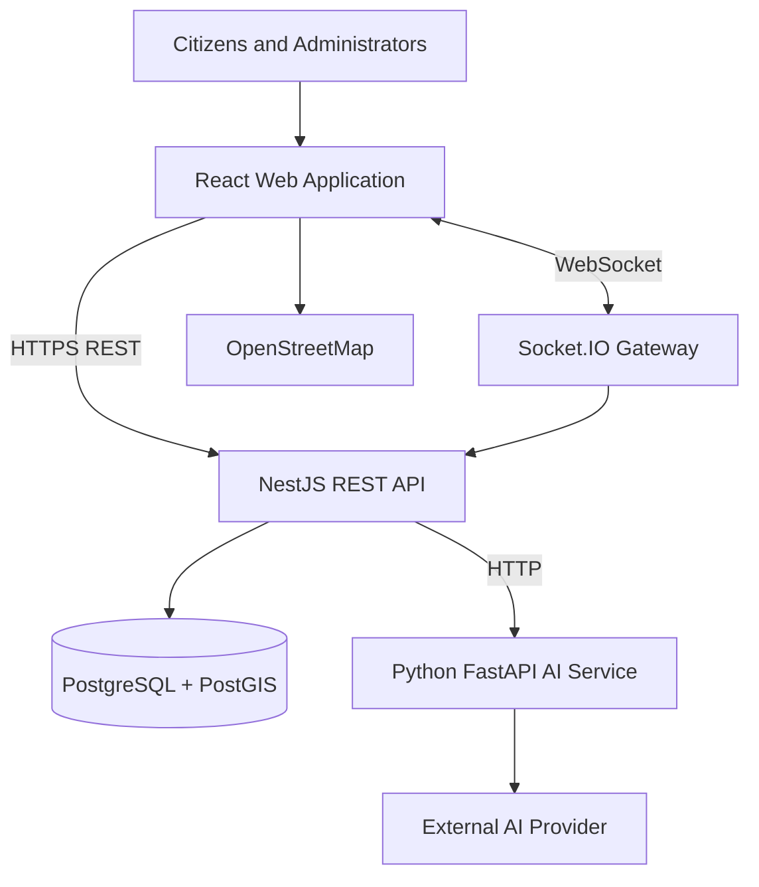

# ARROYO ALERT — System Overview

## 1. Introduction

ARROYO ALERT is a citizen reporting and flood monitoring
platform designed to address urban flooding challenges
in Barranquilla, Colombia.

The platform aims to collect, validate, analyze and
visualize citizen reports related to flooding, dangerous
water streams and environmental incidents.

## 2. Project Objectives

- Improve access to flood-related information.
- Enable geolocated citizen reports.
- Support incident monitoring through interactive maps.
- Facilitate real-time community alerts.
- Assist incident classification through artificial intelligence.
- Provide administrative and moderation capabilities.

## 3. System Architecture

ARROYO ALERT follows a modular monolith architecture
for its core backend, supported by an independent
artificial intelligence service.

The architecture prioritizes maintainability, security,
scalability and separation of concerns.



## 4. System Components

### 4.1 Frontend

The frontend will provide the user interface for
citizens, moderators and administrators.

Technologies:

- React
- TypeScript
- Vite
- Tailwind CSS
- Leaflet
- OpenStreetMap

### 4.2 Backend

The backend is responsible for business logic,
authentication, authorization, data validation,
incident management and API communication.

Technologies:

- Node.js
- NestJS
- TypeScript
- TypeORM
- Zod
- JWT
- Socket.IO
- Swagger

### 4.3 Database

PostgreSQL is the primary relational database.

PostGIS provides geospatial capabilities for
geographic coordinates, spatial queries and
location-based incident management.

Database schema changes are managed through
versioned migrations.

### 4.4 Artificial Intelligence Service

An independent Python service will assist with:

- Citizen report classification.
- Incident severity estimation.
- Report evidence analysis.
- Information summarization.

The initial implementation will integrate an external
AI provider through FastAPI.

AI-generated results are advisory and must not be
treated as official emergency warnings or guarantees
of safety.

### 4.5 Infrastructure

The development infrastructure uses:

- Docker
- Docker Compose
- GitHub
- GitHub Actions

Development and testing databases are isolated.

## 5. Architectural Principles

- Separation of concerns.
- Modular architecture.
- Secure configuration management.
- Environment isolation.
- Migration-based database management.
- Automated testing.
- Continuous integration.
- API-first development.
- Maintainability and scalability.
- Human oversight of AI-assisted decisions.

## 6. Repository Structure

```text
arroyo-alert/
├── frontend/
├── backend/
├── ai-service/
├── infrastructure/
├── docs/
├── .github/
│   └── workflows/
├── .editorconfig
├── .gitignore
└── README.md
```

## 7. Implementation Status

| Component | Status |
|---|---|
| Monorepo | Implemented |
| NestJS backend foundation | Implemented |
| Environment configuration | Implemented |
| PostgreSQL and PostGIS | Implemented |
| TypeORM migrations | Implemented |
| Database health check | Implemented |
| Automated testing | Implemented |
| Continuous integration | Implemented |
| Frontend application | Planned |
| Authentication and authorization | Planned |
| Citizen reporting | Planned |
| Incident management | Planned |
| Interactive maps | Planned |
| Real-time notifications | Planned |
| Artificial intelligence service | Planned |
| Production deployment | Planned |

## 8. Project Scope

The initial MVP will focus on selected sectors of
Barranquilla before expanding to broader geographic
coverage.

ARROYO ALERT is designed as a community information
platform and does not replace official emergency
management authorities.