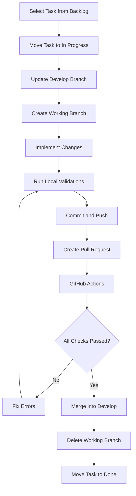

# ARROYO ALERT — Git Workflow

## 1. Overview

ARROYO ALERT follows a simplified Git Flow strategy
adapted to incremental development and Scrum.

The workflow promotes traceability, code quality
and controlled integration.

## 2. Branch Strategy

### Main Branches

| Branch | Purpose |
|---|---|
| main | Stable release-ready code |
| develop | Integration and ongoing development |

### Temporary Branches

| Prefix | Purpose |
|---|---|
| feature/ | New functionality |
| fix/ | Bug fixes |
| chore/ | Maintenance and configuration |
| docs/ | Documentation |
| hotfix/ | Urgent production fixes |

## 3. Branch Naming Convention

Branch names must include the corresponding
project task identifier when available.

Examples:

```text
feature/AA-009-user-management
feature/AA-010-authentication
fix/AA-025-report-validation
chore/AA-002-monorepo-setup
docs/AA-008-technical-documentation
```

Task identifiers in these examples are illustrative.

## 4. Development Workflow



## 5. Start a New Task

```bash
git switch develop
git pull origin develop
git switch -c feature/AA-XXX-task-name
```

Use the appropriate branch prefix for
the corresponding task.

## 6. Conventional Commits

Commit messages should follow the
Conventional Commits specification.

Format:

```text
type(scope): description
```

### Commit Types

| Type | Purpose |
|---|---|
| feat | New functionality |
| fix | Bug correction |
| docs | Documentation changes |
| chore | Maintenance |
| refactor | Code restructuring |
| test | Test changes |
| ci | Continuous integration |
| build | Build configuration |
| perf | Performance improvements |
| style | Formatting changes |

### Examples

```text
feat(auth): implement user authentication
fix(reports): validate geographic coordinates
docs(architecture): update database design
test(health): add database availability tests
ci(backend): configure PostgreSQL service
chore(deps): update project dependencies
```

Commit messages must be written in English.

Commits should represent focused and
meaningful changes.

## 7. Local Validation

Before committing backend changes:

```bash
npm run format
npm run lint -- --deny-warnings
npm run test
npm run test:e2e
npm run build
```

Run these commands from the backend directory
with the testing database available.

Documentation-only changes require appropriate
documentation review and all required CI checks.

## 8. Review Changes

```bash
git status
git diff
git diff --check
```

Stage the intended files:

```bash
git add .
git diff --cached --stat
git diff --cached --name-only
git diff --cached --check
```

Verify that environment credentials and
unnecessary generated files are not staged.

## 9. Commit and Push

```bash
git commit -m "feat(scope): describe the change"
git push -u origin HEAD
```

## 10. Pull Request Guidelines

Pull requests must contain:

- A descriptive title.
- A clear description.
- A summary of changes.
- Testing and validation results.
- Security considerations when applicable.
- The related project task.

### Pull Request Template

```text
## Description

Describe the purpose of the changes.

## Changes

- Change 1
- Change 2

## Testing and Validation

- [ ] Local validations passed.
- [ ] Automated tests passed.
- [ ] GitHub Actions passed.

## Related Task

AA-XXX
```

## 11. Branch Protection

The project follows these branch protection principles:

- Changes must be integrated through pull requests.
- Required continuous integration checks must pass.
- Review conversations must be resolved when required.
- Force pushes to protected branches are prohibited.
- Protected branch deletion is prohibited.

The exact enforced rules are managed through
GitHub repository rulesets.

Independent review should be introduced when
additional developers join the project.

## 12. Continuous Integration

The following checks must pass:

- Validate project structure.
- Validate backend.
- Validate infrastructure.

A pull request must not be merged while
required checks are failing.

## 13. Merge and Cleanup

After successful validation, merge the pull
request into the appropriate target branch.

For standard development tasks, use develop.

Delete the remote working branch after the merge.

Update the local repository:

```bash
git switch develop
git pull origin develop
git branch -d feature/AA-XXX-task-name
git fetch --prune
```

Use the actual completed branch name.

## 14. Release Workflow

Stable and validated changes will be promoted
from develop to main through a pull request.

Release versioning and deployment automation
will be defined before the first production release.

## 15. Definition of Done

A development task is complete when:

- Acceptance criteria are satisfied.
- Implementation is completed.
- Relevant tests are included.
- Local validations pass.
- Documentation is updated.
- Required CI checks pass.
- The pull request is merged.
- The project task is updated.

## 16. Repository Security

Never commit:

- Real environment files.
- Passwords.
- API keys.
- Authentication tokens.
- Private keys.
- Database backups containing sensitive data.
- node_modules directories.
- Generated build artifacts.

Only sanitized environment templates may
be committed.