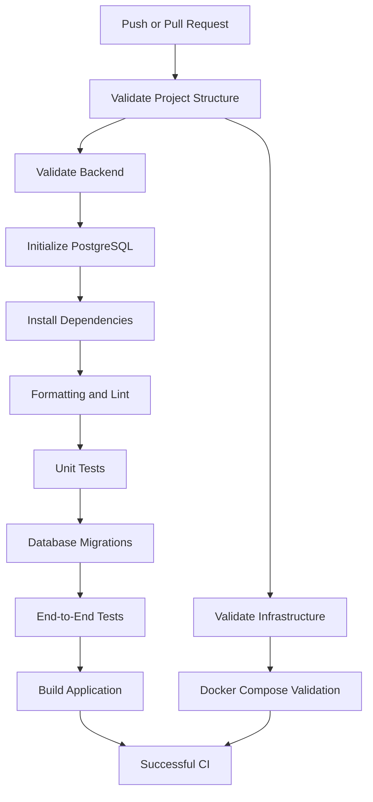
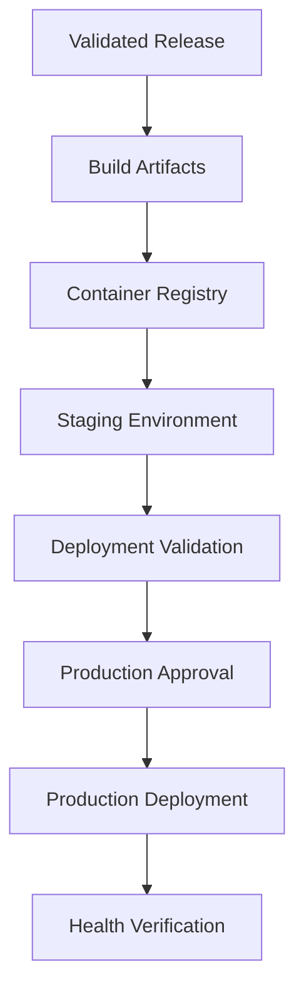

# ARROYO ALERT — CI/CD Strategy

## 1. Overview

ARROYO ALERT uses GitHub Actions to automate
software quality validation and continuous
integration.

Continuous deployment will be introduced
during future project stages.

## 2. Objectives

- Detect development errors early.
- Enforce development standards.
- Validate application behavior.
- Protect integration branches.
- Verify database migrations.
- Improve development consistency.
- Support future automated deployments.

## 3. Workflow Configuration

The main continuous integration workflow is
located at:

`.github/workflows/ci.yml`

Workflow name:

`ARROYO ALERT CI`

## 4. Workflow Triggers

The workflow runs on pushes to:

- main
- develop
- feature/**
- fix/**
- chore/**
- docs/**
- hotfix/**

It also runs on pull requests targeting:

- main
- develop

## 5. Pipeline Architecture



Backend and infrastructure validation execute
independently after successful project
structure validation.

## 6. Project Structure Validation

Job name:

`Validate project structure`

Responsibilities:

- Verify required project directories.
- Verify essential configuration files.
- Detect tracked environment files.
- Protect repository organization.

Required directories:

- frontend
- backend
- ai-service
- infrastructure
- docs
- .github/workflows

Required configuration files:

- README.md
- .gitignore
- .editorconfig

Only sanitized environment templates
are permitted in version control.

## 7. Backend Validation

Job name:

`Validate backend`

Runner:

`ubuntu-latest`

Runtime:

`Node.js 24`

### Validation Steps

1. Initialize the database service.
2. Checkout the repository.
3. Configure Node.js.
4. Install dependencies using npm ci.
5. Validate formatting using Prettier.
6. Run static analysis using Oxlint.
7. Execute unit tests.
8. Apply database migrations.
9. Execute end-to-end tests.
10. Build the NestJS application.
11. Clean up temporary resources.

## 8. PostgreSQL Service

GitHub Actions initializes an independent
PostgreSQL and PostGIS service.

Container image:

`postgis/postgis:16-3.7`

### Testing Configuration

| Variable | Value |
|---|---|
| NODE_ENV | test |
| DB_HOST | 127.0.0.1 |
| DB_PORT | 5435 |
| DB_USER | arroyo_test |
| DB_NAME | arroyo_alert_test |

The database uses temporary credentials
defined for CI purposes.

CI credentials must never be reused in
development or production.

The database service is removed when the
workflow job finishes.

## 9. Infrastructure Validation

Job name:

`Validate infrastructure`

Responsibilities:

- Verify Docker Compose availability.
- Validate Docker Compose configuration.
- Detect infrastructure configuration errors.

Validation command:

```bash
docker compose --env-file .env.example config --quiet
```

This command validates the Compose configuration.
It does not start the infrastructure containers.

## 10. Security Configuration

The CI workflow uses read-only repository
permissions:

```yaml
permissions:
  contents: read
```

Repository checkout credentials are not
persisted when they are not required.

Real environment files and production
credentials must never be committed.

Future production secrets must be managed
through protected environments or an appropriate
secret management service.

## 11. Branch Protection

The repository follows these protection principles:

- Pull request-based integration.
- Required status checks.
- Restricted force pushes.
- Restricted protected branch deletion.
- Resolution of review conversations when required.

The exact active configuration is maintained
through GitHub repository rulesets.

## 12. Failure Handling

When a CI check fails:

1. Identify the failed job.
2. Review the execution logs.
3. Reproduce the problem locally when possible.
4. Correct the underlying issue.
5. Run local validations.
6. Commit and push the correction.
7. Verify the updated CI execution.

Required checks must not be bypassed
to integrate failing changes.

## 13. Continuous Deployment Roadmap

Continuous deployment is not implemented yet.

Future deployment automation may include:

- Frontend build and deployment.
- Backend container image generation.
- AI service container image generation.
- Container registry integration.
- Staging environment deployment.
- Production deployment.
- Database migration execution.
- Deployment health verification.
- Rollback procedures.

The production hosting provider has not
been selected in this document.

## 14. Planned Deployment Architecture



This diagram represents a proposed future
deployment workflow.

## 15. Production Safety Requirements

Before enabling production deployment:

- Define secure infrastructure.
- Configure production secrets.
- Establish database backup procedures.
- Define migration approval processes.
- Implement monitoring and logging.
- Configure HTTPS.
- Establish rollback procedures.
- Define deployment access permissions.

## 16. Current Implementation Status

| Capability | Status |
|---|---|
| Continuous integration | Implemented |
| Structure validation | Implemented |
| Environment file validation | Implemented |
| Backend quality checks | Implemented |
| PostgreSQL service | Implemented |
| Database migrations in CI | Implemented |
| Automated testing | Implemented |
| Infrastructure validation | Implemented |
| Container image publishing | Planned |
| Staging deployment | Planned |
| Production deployment | Planned |
| Automated rollback | Planned |

## 17. Continuous Improvement

CI/CD workflows will evolve as additional
application components are implemented.

Automation should reduce repetitive work
without weakening security or quality controls.