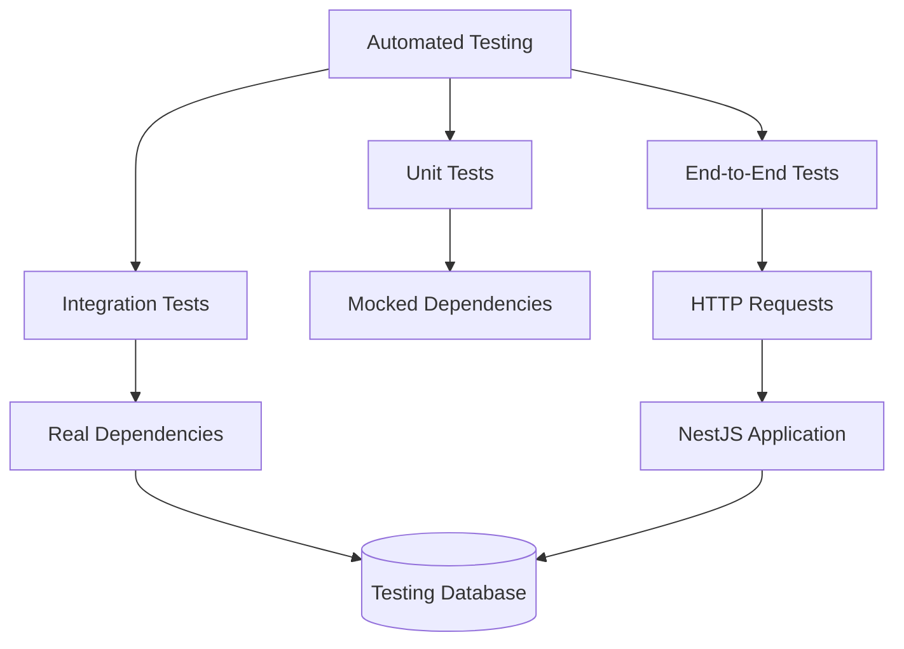

# ARROYO ALERT — Testing Strategy

## 1. Purpose

The testing strategy ensures that ARROYO ALERT
remains reliable, maintainable, secure and
consistent throughout its development lifecycle.

Automated testing is an essential part of the
project's quality assurance process.

## 2. Testing Technologies

| Technology | Purpose |
|---|---|
| Vitest | Automated test execution |
| Supertest | HTTP endpoint testing |
| V8 Coverage | Code coverage analysis |
| NestJS Testing Module | Dependency injection testing |
| PostgreSQL | Database integration testing |
| PostGIS | Geospatial integration testing |
| GitHub Actions | Continuous integration |

## 3. Testing Architecture



The current implementation includes unit tests
and end-to-end tests covering database integration.

Additional integration test suites may be
introduced when required.

## 4. Unit Testing

Unit tests verify individual components in isolation.

Dependencies should be mocked when appropriate.

Unit testing focuses on:

- Business rules.
- Service behavior.
- Controller behavior.
- Environment validation.
- Error handling.
- Security validations.
- Boundary conditions.

Unit test files use the following naming convention:

`*.spec.ts`

Example:

```typescript
it('should reject an invalid report', async () => {
  // Arrange
  // Act
  // Assert
});
```

## 5. Arrange, Act and Assert

Tests should follow the AAA pattern.

### Arrange

Prepare the required dependencies, data and mocks.

### Act

Execute the operation being tested.

### Assert

Verify the expected behavior.

This pattern improves readability and consistency.

## 6. Integration Testing

Integration tests verify communication between
application components and external dependencies.

Integration testing may cover:

- Database repositories.
- Entity relationships.
- Database transactions.
- Spatial queries.
- External service communication.
- Database migrations.

Real dependencies must use isolated
testing environments.

## 7. End-to-End Testing

End-to-end tests verify application behavior
through real HTTP requests.

The tests initialize the NestJS application
and communicate with the testing database.

End-to-end testing covers:

- HTTP response status codes.
- Response structures.
- Database connectivity.
- API validation.
- Authentication and authorization.
- Business workflows.
- Database persistence.
- Error responses.

Authentication, authorization and business
workflow tests will be added as the corresponding
features are implemented.

End-to-end test files use:

`*.e2e-spec.ts`

## 8. Database Isolation

Testing must never use development or
production databases.

The testing environment uses:

| Configuration | Value |
|---|---|
| NODE_ENV | test |
| DB_HOST | 127.0.0.1 |
| DB_PORT | 5435 |
| DB_NAME | arroyo_alert_test |
| DB_USER | arroyo_test |

Isolation is enforced through:

- Independent Docker containers.
- Independent database credentials.
- Zod environment validation.
- Database identity verification.
- Separate database volumes and networks.

## 9. Database Migration Testing

Database migrations must be applied to the
testing database before running E2E tests.

```bash
npm run migration:run:test
npm run migration:show:test
```

Migration testing should verify:

- Successful execution.
- Expected database structure.
- Required extensions.
- Data integrity.
- Compatibility with existing records.
- Rollback behavior when applicable.

## 10. Test Execution

Run the following commands from the
backend directory.

### Unit Tests

```bash
npm run test
```

### Specific Test File

```bash
npm run test -- src/modules/health/health.service.spec.ts
```

### Code Coverage

```bash
npm run test:cov
```

### End-to-End Tests

```bash
npm run test:e2e
```

### Complete Validation

```bash
npm run format
npm run lint -- --deny-warnings
npm run test
npm run migration:run:test
npm run test:e2e
npm run build
```

## 11. Code Coverage

Code coverage helps identify application code
that has not been exercised by automated tests.

The project measures:

- Statement coverage.
- Branch coverage.
- Function coverage.
- Line coverage.

### Proposed Coverage Targets

| Metric | Target |
|---|---:|
| Statements | 80% |
| Branches | 80% |
| Functions | 80% |
| Lines | 80% |

These targets are proposed quality guidelines.
They are not currently enforced by the CI pipeline.

Coverage alone does not guarantee software quality.

Critical security and business rules require
meaningful test cases regardless of coverage.

## 12. Initial Testing Baseline

At the completion of AA-007, the project
achieved the following results:

| Test Type | Passed |
|---|---:|
| AppController | 1 |
| HealthController | 4 |
| HealthService | 9 |
| Environment Validation | 37 |
| End-to-End | 7 |
| Total | 58 |

### Coverage Baseline

| Metric | Coverage |
|---|---:|
| Statements | 100% |
| Branches | 83.33% |
| Functions | 100% |
| Lines | 100% |

These results represent the AA-007 baseline
and apply to the files included in the
coverage report.

They will evolve as new features are implemented.

## 13. Future Testing Requirements

### Authentication

- Valid and invalid credentials.
- Password protection.
- Token expiration.
- Token refresh.
- Token revocation.

### Authorization

- Role validation.
- Permission validation.
- Protected resources.
- Unauthorized access prevention.

### Citizen Reports

- Report creation.
- Required field validation.
- Geographic coordinate validation.
- Evidence validation.
- Report ownership.

### Incident Management

- Report association.
- Incident status transitions.
- Geographic queries.
- Severity management.

### Artificial Intelligence

- Invalid provider responses.
- Provider failures.
- Request timeouts.
- Output validation.
- Human oversight requirements.

### Alerts

- Authorized publication.
- Alert expiration.
- Invalid status transitions.
- Prevention of unauthorized publication.

## 14. Continuous Integration

GitHub Actions automatically executes:

- Formatting validation.
- Static code analysis.
- Unit tests.
- Database migrations.
- End-to-end tests.
- Application compilation.

Pull requests must pass the required checks
before integration.

## 15. Definition of Done

Testing is complete when:

- Relevant test cases are implemented.
- Successful and unsuccessful scenarios are covered.
- Critical business rules are verified.
- Environment isolation is respected.
- Automated tests pass.
- Required CI checks pass.
- Relevant documentation is updated.

## 16. Continuous Improvement

The testing strategy will evolve alongside
the application architecture.

New features must introduce appropriate tests
and preserve existing application behavior.